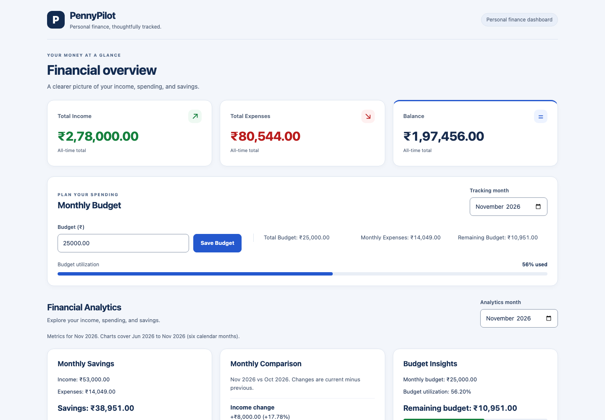
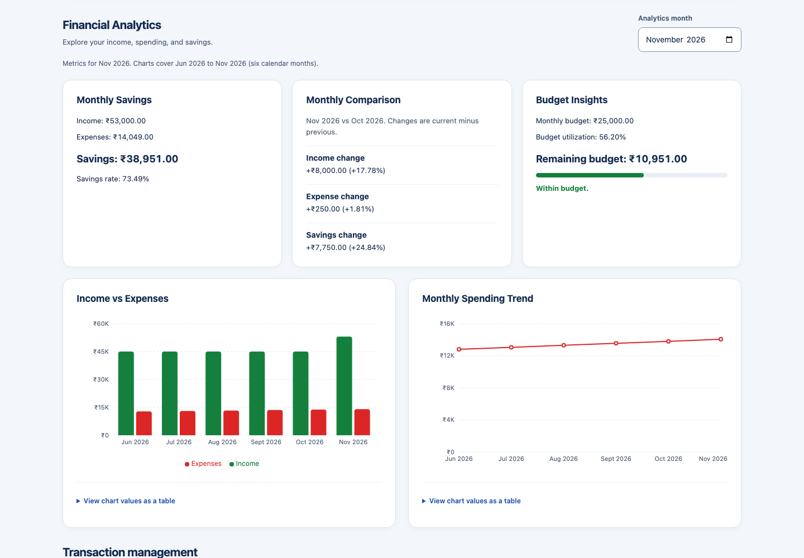
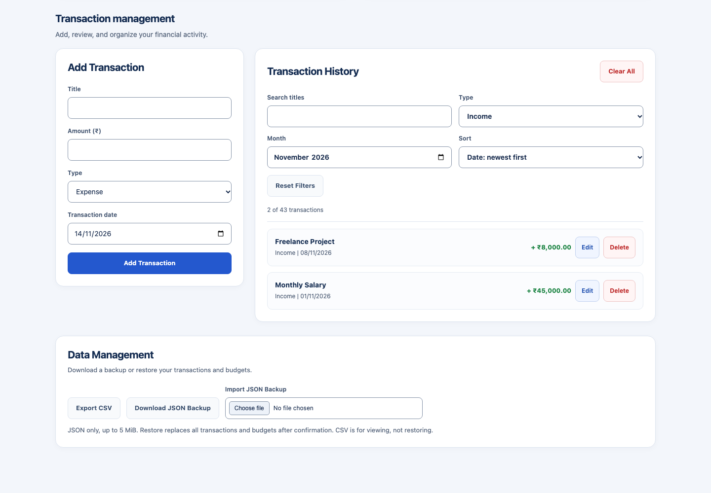
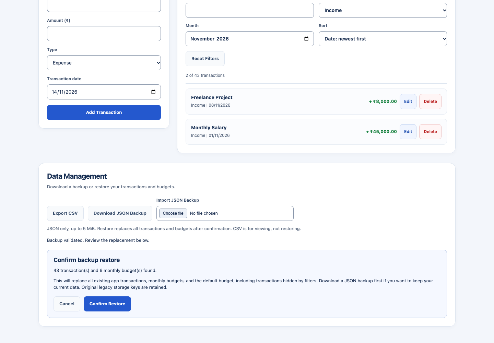
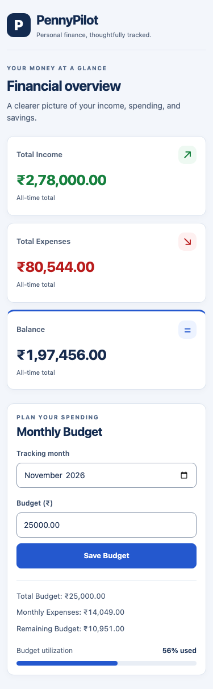

# PennyPilot

**Personal Finance Management System**

**Live demo:** [https://pennypilot-mauve.vercel.app/](https://pennypilot-mauve.vercel.app/)

PennyPilot is a responsive, local-first finance dashboard built with React and JavaScript. Track income and expenses, plan monthly budgets, explore financial trends, and keep downloadable backups—all without an account or backend.

## Features

- **Transaction management:** add, edit, delete, search, filter by type/month, and sort by date or amount. Clearing all history requires confirmation and retains budgets.
- **Financial overview:** all-time income, expenses, and balance, with Indian rupee formatting and exact integer-paise arithmetic.
- **Monthly budgets:** independent budgets for each month, utilization, remaining amounts, and overspending indicators. Unconfigured months use the migrated default budget, or ₹10,000 for new users.
- **Analytics:** monthly income/expense bars, a six-calendar-month spending trend with zero-filled months, savings rates, and comparisons with the previous month. The analytics selector is independent of transaction filters and the budget selector.
- **Backup and recovery:** CSV export, versioned JSON backup, and validated JSON restore with a preview and explicit confirmation.
- **Usability:** responsive cards and controls, labeled forms, keyboard focus indicators, chart data tables, empty states, and reduced-motion support. Full accessibility conformance is not claimed.

No authentication, cloud synchronization, transaction categories, or server-side storage is implemented.

## Technology stack

| Area | Technology |
| --- | --- |
| UI | React 19, JavaScript/JSX, CSS |
| Charts | Recharts 3 |
| Development/build | Vite 8, npm |
| Persistence | Browser localStorage |
| Tests | Node.js built-in test runner and assertions |

Charts load as a separate bundle. If their download fails, transactions, budgets, and backups remain available.

## Project structure

```text
src/
  App.jsx
  main.jsx
  index.css
  components/
    BudgetSection.jsx
    DataManagement.jsx
    SummaryCard.jsx
    TransactionForm.jsx
    TransactionList.jsx
    analytics/             # Charts, summaries, comparison and budget insights
  utils/
    finance.js             # Validation, exact money, filtering and IDs
    analytics.js           # Calendar aggregation and analytics calculations
    storage.js             # Versioned persistence and legacy migration
    backup.js              # CSV/JSON export, validation and atomic restore
tests/                     # 45 automated tests
index.html
package.json
package-lock.json
SCREENSHOT_PLAN.md
QA_REPORT.md
PHASE2_REPORT.md … PHASE6A_REPORT.md
```

## Installation

Use **Node.js 24.x** and npm to match the audited setup. Vite requires a supported Node release with at least Node 22.12 for the recommended 22+ line.

```sh
git clone https://github.com/rrayyann7811/pennypilot.git
cd pennypilot
npm ci
```

`npm ci` installs the versions recorded in `package-lock.json`. Do not install dependencies inside a parent repository.

## Development and verification

```sh
npm run dev       # Start Vite; open the URL printed in the terminal
npm test          # Run all 45 automated tests
npm run build     # Generate production assets in dist/
npm run preview   # Preview the production build locally
npm audit         # Check current dependency advisories
git diff --check  # Check tracked diffs for whitespace errors
```

Tests cover exact money, dates, filtering, monthly aggregation, savings/comparisons, storage/migration, CSV safety, backup validation, cancellation, failed writes, and import/prototype safety. Browser regressions were run separately using temporary QA tooling; no committed browser automation suite or CI workflow is configured.

The latest verification results and limitations are documented in [PHASE5_REPORT.md](PHASE5_REPORT.md) and [PHASE6A_REPORT.md](PHASE6A_REPORT.md). Older reports record the scope and results at each phase; earlier test counts and bundle sizes are historical.

## Data storage and calculations

Data is stored under `pennypilot.phase1.v1` in the current browser's localStorage. The schema contains transactions, month-specific budgets, and a default budget. There is no write during initial loading.

Transaction amounts are positive integer paise, up to 1,000,000,000,000 paise (₹10,00,00,00,000); budgets also allow zero. Aggregates and monetary differences preserve exact paise with BigInt where needed. Percentages are rounded to two decimal places; zero income and nonpositive comparison baselines show explanations rather than NaN or Infinity. Chart coordinates use Numbers, so extremely large plotted coordinates may approximate values while summaries, tooltips, and tables remain exact.

Original legacy `transactions` and `budget` keys are retained. Ambiguous/invalid legacy date strings are displayed unchanged, included in all-time totals, and excluded from monthly calculations until explicitly corrected. If malformed saved data cannot be loaded safely, writes are disabled to protect the original; the session remains usable with a warning.

## Backup and recovery

Use **Data Management** at the bottom of the dashboard:

1. **Export CSV** downloads all active transactions, including those hidden by filters. Columns are title, amount in INR, type, and date. UTF-8 Unicode, quoted fields, newlines, and exact two-decimal amounts are supported. Formula-like text is prefixed with an apostrophe for spreadsheet safety; some viewers may show that prefix. CSV cannot be imported as a backup.
2. **Download JSON Backup** saves a complete copy of active loaded/session transactions, IDs, dates, monthly budgets, and the default budget.
3. **Import JSON Backup** accepts PennyPilot `.json` backups up to **5 MiB**. The entire file is validated before transaction/budget counts and a replacement explanation appear. Choose **Cancel** to retain current data or **Confirm Restore** to replace it. Download the existing data first if you want to retain it.

JSON backups use `format: "pennypilot-backup"`, `version: 1`, a UTC `exportedAt` timestamp, and a `data` object containing `transactions`, `budgets`, and `defaultBudget`. Amounts remain integer paise. Unresolved legacy dates carry an explicit `dateStatus: "unresolved"` marker; ordinary invalid dates are rejected. See [PHASE4_REPORT.md](PHASE4_REPORT.md) for the complete schema and validation rules.

Malformed JSON, unsupported versions, duplicate IDs, invalid fields, oversized files, read failures, and blocked/full storage reject the restore without replacing existing data. Successful restore uses one storage write before updating the dashboard, retains original legacy keys, resets history filters, and cancels an active edit. It does not merge data and has no built-in undo.

## Privacy and limitations

- Financial records are not uploaded by the application. There is no login, encryption, server backup, or automatic synchronization. Anyone with access to the same browser profile can inspect its data.
- JSON and CSV files are **unencrypted** financial records. Store and share them carefully. Exports omit credentials, cookies, browser history, and unrelated browser metadata.
- localStorage belongs to an exact origin and browser profile. Localhost, preview URLs, production URLs, and custom domains have separate data. Use a JSON backup to transfer records between them.
- Clearing site data, private browsing, browser quota limits, or losing a device can remove data. Keep backups; avoid simultaneous editing in several tabs because there is no conflict resolution.
- Backups contain active loaded/session records. Corrupt raw records skipped by the loader and original raw legacy keys are not included. Preserve those originals separately when recovering damaged storage.
- All JSON backups must fit 5 MiB; browser storage quota may be smaller. Large histories render all matching rows and use synchronous storage writes; pagination and virtualization are not implemented.
- Physical-device, Safari/Firefox, screen-reader, and live-hosting verification remain manual. Hosting providers may retain ordinary request logs even though the app does not send financial records.

## Vercel deployment

The app builds to static assets; no backend, environment variables, server functions, or custom routing configuration is required.

| Setting | Value |
| --- | --- |
| Framework preset | Vite |
| Root directory | Repository root |
| Node.js version | 24.x |
| Install command | `npm ci` |
| Build command | `npm run build` |
| Output directory | `dist` |

Run the verification commands before publishing. Serve the generated static assets rather than exposing the Vite development/preview server. Verify a preview's asset loading, restore workflow, and device/browser behavior before a public release. Export a backup before changing the application origin.

See the official [Vercel Vite guide](https://vercel.com/docs/frameworks/frontend/vite) and [Node.js version settings](https://vercel.com/docs/functions/runtimes/node-js/node-js-versions). No deployment or GitHub release has been performed as part of repository preparation.

## Screenshots

These are real captures of the production preview in an isolated Chrome profile. All records are fictional demonstration data across June–November 2026; November uses the sample income and expenses, with a ₹25,000 monthly budget. No personal browser data is shown.

### Main dashboard



### Financial analytics



### Transaction management



### Data backup and recovery



### Mobile layout



Desktop captures are 1440 × 1000 pixels; the mobile overview is 375 × 1206 pixels. PNGs use lossless compression without retouching, rescaling, or fabricated UI. See [SCREENSHOT_PLAN.md](SCREENSHOT_PLAN.md) for capture details.

## Author

**Syed Rayyan Ali**

GitHub: [rrayyann7811](https://github.com/rrayyann7811)
